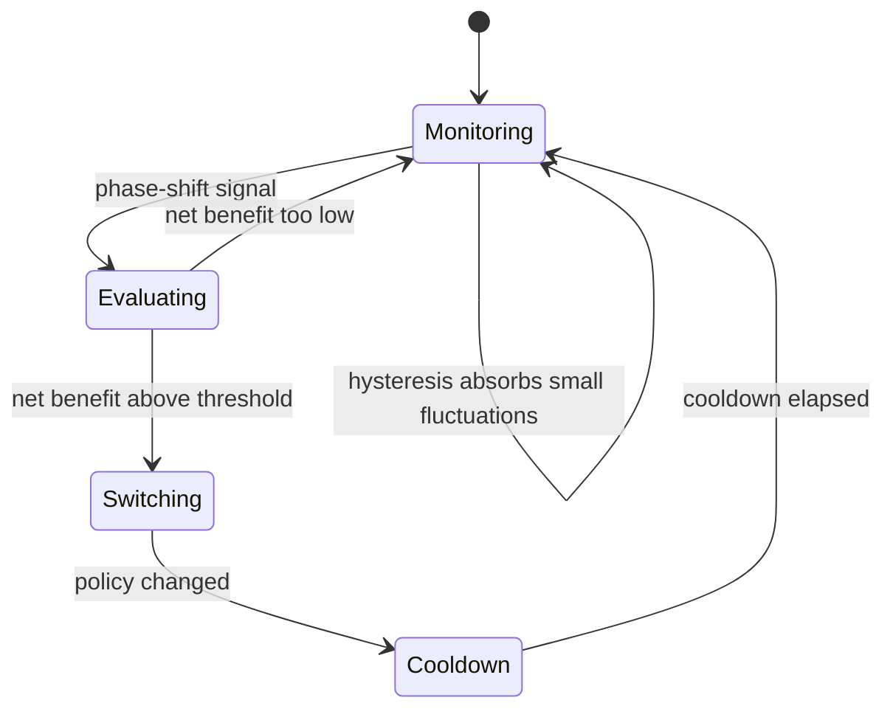

<div align="center">


<a href="https://github.com/your-username/memora">
  
</a>

<br/>


**[Overview](#-overview)** ·
**[Architecture](#-architecture)** ·
**[How it works](#-how-it-works)** ·
**[Quick start](#-quick-start)** ·
**[Experiments](#-experimental-evaluation)** ·
**[PostgreSQL](#-postgresql-validation)** ·
**[Roadmap](#-roadmap)**

</div>

---

## ✨ Overview

No single eviction policy wins on every workload. **LRU** shines on recency, **LFU** on skewed hot sets, and **FIFO** is hard to beat on one-pass scans. Real database workloads move between these regimes, so a fixed policy is always wrong some of the time.

**MEMORA** watches the page-access stream, recognises when the workload changes character, and switches policy **only when the expected gain outweighs the cost of switching**.

<table>
<tr>
<td width="33%" valign="top">

### 🔍 Sees the phase
A sliding-window detector tracks frequency divergence, entropy, sequentiality and reuse distance.

</td>
<td width="33%" valign="top">

### ⚖️ Weighs the cost
Expected hit-ratio gain is compared against switching overhead and cold-miss penalty.

</td>
<td width="33%" valign="top">

### 🛡️ Stays stable
Hysteresis, cooldown and a minimum net-benefit gate stop thrashing on noisy workloads.

</td>
</tr>
</table>

---

## 🧩 Key Components

| | Component | What it does |
|:-:|---|---|
| 🧪 | **Trace-Driven Simulation Core** | High-performance buffer pool simulation with LRU, LFU and FIFO eviction. |
| 📡 | **Workload Intelligence** | Sliding-window phase detector: Jensen–Shannon divergence, access entropy, sequentiality, reuse distance. |
| 🧮 | **Cost-Benefit Decision Engine** | Compares expected hit-ratio improvement with switching overhead and cold-miss penalty. |
| 🧯 | **Anti-Thrashing Adaptive Controller** | Hysteresis, cooldown periods and minimum net-benefit gating for stability. |
| 📊 | **Experimental Evaluation** | Synthetic benchmarks: recency, frequency/Zipfian, sequential scans, mixed and phase-shifting. |
| 🐘 | **PostgreSQL Validation** | Cross-checks against PostgreSQL buffer cache statistics via `pg_stat_statements` and `pgbench`. |

---

## 🏗️ Architecture

<div align="center">
  
</div>

<details>
<summary><b>Plain-text version</b></summary>

```
Workload Trace / Real DBMS Access Stream
                  │
                  ▼
       ┌─────────────────────┐
       │     Buffer Pool     │◄────────────┐
       │ (Frames, Hit/Miss)  │             │ Policy Switch
       └──────────┬──────────┘             │ (LRU / LFU / FIFO)
                  │ Access Stream          │
                  ▼                        │
       ┌─────────────────────┐             │
       │   Phase Detector    │             │
       │ (JSD, Entropy, Seq) │             │
       └──────────┬──────────┘             │
                  │ Phase Detection Signal │
                  ▼                        │
       ┌─────────────────────┐             │
       │ Cost-Benefit Engine │─────────────┘
       │  (Net Benefit Gate) │
       └─────────────────────┘
```

</details>

---

## 🧠 How it works

### 1 · Detect the phase

Each window of accesses is summarised by four signals:

| Signal | Question it answers | Typical meaning |
|---|---|---|
| **Jensen–Shannon divergence** | Did the page-frequency distribution shift versus the previous window? | High → new working set |
| **Access entropy** | How spread out are the accesses? | Low → concentrated hot set, high → uniform |
| **Sequentiality** | Are consecutive requests adjacent pages? | High → scan |
| **Reuse distance** | How soon are pages touched again? | Short → recency-friendly |

### 2 · Decide with a cost-benefit gate

A switch is attempted only when the detector signals a phase change, and it is executed only if

```text
net_benefit = (expected_hit_gain × window_requests × miss_cost)
              − switch_overhead − cold_miss_penalty

switch  ⇔  net_benefit > min_net_benefit
```

### 3 · Stay stable under noise



### 4 · See it in action

<div align="center">
  
</div>

> The chart above is an **illustration of the intended behaviour**. Run the demo to see real numbers from your own traces.

---

## 🚀 Quick Start

```bash
# Clone the repository and install dependencies
pip install -e .[dev]

# Run the test suite
pytest tests/ -v

# Run the demonstration script
python scripts/run_demo.py
```

<details>
<summary><b>Full setup from scratch</b></summary>

```bash
git clone https://github.com/your-username/memora.git
cd memora
python -m venv .venv
source .venv/bin/activate        # Windows: .venv\Scripts\activate
pip install -e .[dev]
pytest tests/ -v
python scripts/run_demo.py
```

</details>

---

## 📊 Experimental Evaluation

MEMORA is benchmarked on synthetic workloads that each favour a different policy:

| Workload | Pattern | Policy that should win | What MEMORA is tested on |
|---|---|:-:|---|
| **Recency** | Recently used pages are reused | LRU | Staying on LRU without needless switches |
| **Frequency / Zipfian** | Small hot set dominates | LFU | Moving to LFU once skew appears |
| **Sequential scan** | One-pass, little reuse | FIFO | Avoiding cache pollution |
| **Mixed** | Several patterns interleaved | varies | Not thrashing between policies |
| **Phase-shifting** | Workload changes over time | adaptive | Tracking each phase with minimal switches |

Baselines are fixed LRU, fixed LFU and fixed FIFO. Reproduce the runs with `python scripts/run_demo.py`.

---

## 🐘 PostgreSQL Validation

Simulation results are cross-checked against a real engine:

1. Generate load with **`pgbench`**.
2. Collect buffer-cache behaviour with **`pg_stat_statements`** and the buffer cache statistics views.
3. Compare real hit/read ratios with those predicted by the simulator on the equivalent access trace.

---

## 🗺️ Roadmap

- [x] Trace-driven buffer pool with LRU / LFU / FIFO
- [x] Sliding-window phase detector (JSD, entropy, sequentiality, reuse distance)
- [x] Cost-benefit engine with anti-thrashing controller
- [x] Synthetic workload benchmarks
- [x] PostgreSQL cross-validation
- [ ] Additional policies (e.g. ARC, CLOCK, 2Q)
- [ ] Live-DBMS plug-in mode
- [ ] Interactive dashboard for traces and switch decisions

---

## 🤝 Contributing

Contributions are welcome.

1. Fork the repo and create a branch: `git checkout -b feature/my-idea`
2. Add tests and make sure `pytest tests/ -v` passes
3. Open a pull request describing what changed and why

---

## 👥 Team

**Team MEMORA — Saviours of Memory**

<!-- Add contributors here, e.g.:
<a href="https://github.com/your-username"></a>
-->

---

<div align="center">


**If MEMORA helped you, consider giving it a ⭐**

</div>
