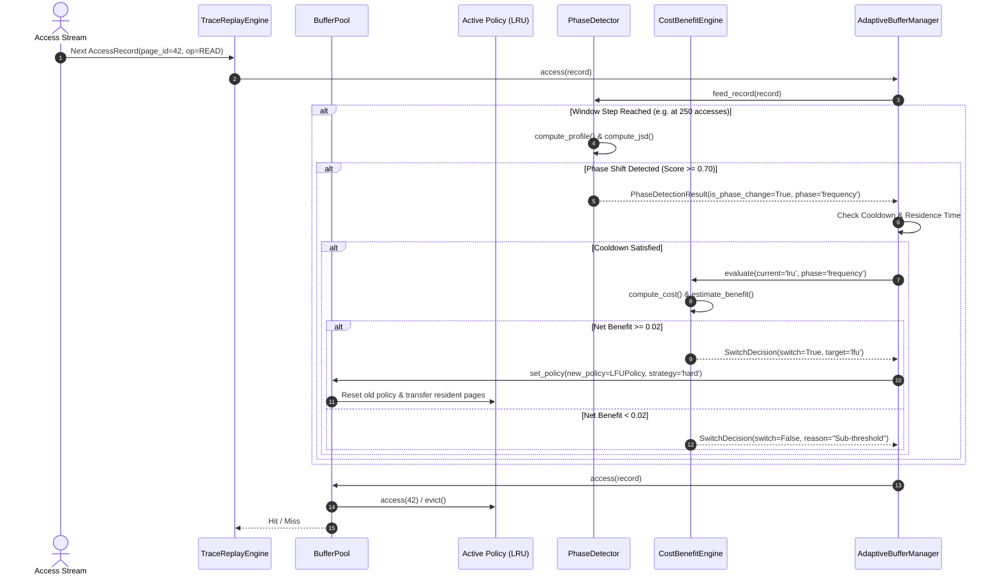

# MEMORA System Architecture Specification

## 1. System Overview

**MEMORA (Saviours of Memory)** is an intelligent, workload-aware buffer management system for relational database management systems (DBMS). Unlike conventional static replacement algorithms—which enforce a single fixed eviction policy (such as LRU, LFU, or FIFO) regardless of the shifting access profile—MEMORA introduces a dynamic arbitration and adaptation layer that operates continuously above baseline replacement engines.

The primary research objective of MEMORA is to determine:
> *"When does the workload change enough that switching buffer replacement policies is worth the transient cost of switching?"*

To solve this, MEMORA distinguishes between four operational regimes:
- **Case A — Stable Workload**: Minor stochastic access fluctuations do not trigger policy transitions.
- **Case B — Genuine Workload Phase Change**: Statistically significant shifts in temporal or spatial locality trigger evaluation of alternative candidate policies.
- **Case C — Change Detected but Switching Not Worthwhile**: A phase change is confirmed, but the expected hit-ratio benefit is insufficient to offset the transient cold-miss and state migration penalties. The current policy is retained.
- **Case D — Change Detected and Switching Worthwhile**: The expected net benefit strictly exceeds the configured minimum threshold ($\Delta > \tau_{net}$), and anti-thrashing constraints are met. The system transitions to the superior policy.

---

## 2. Component Architecture

```
                    ACCESS TRACE / DBMS STREAM
                                 │
                                 ▼
                    ┌─────────────────────────┐
                    │      TraceLoader        │
                    └────────────┬────────────┘
                                 │
                                 ▼
                    ┌─────────────────────────┐
                    │   TraceReplayEngine     │
                    └────────────┬────────────┘
                                 │
                                 ▼
                    ┌─────────────────────────┐
                    │       BufferPool        │◄─────────────┐
                    │    (Frames & PageTable) │              │
                    └──────┬───────────┬──────┘              │
                           │           │                     │ Policy Switch
               Eviction /  │           │ Access Event Tap    │ (State Migration)
               Tracking    │           │                     │
                           ▼           ▼                     │
                    ┌────────────┐┌─────────────────────┐    │
                    │Replacement ││ MetricsCollector    │    │
                    │   Policy   │└─────────────────────┘    │
                    │(LRU/LFU/FF)│                           │
                    └────────────┘                           │
                                       │                     │
                                       ▼                     │
                              ┌─────────────────────┐        │
                              │ SlidingWindowManager│        │
                              └────────┬────────────┘        │
                                       │                     │
                                       ▼                     │
                              ┌─────────────────────┐        │
                              │   WorkloadProfile   │        │
                              │ (Entropy, Seq, JSD) │        │
                              └────────┬────────────┘        │
                                       │                     │
                                       ▼                     │
                              ┌─────────────────────┐        │
                              │    PhaseDetector    │        │
                              └────────┬────────────┘        │
                                       │                     │
                                       ▼                     │
                              ┌─────────────────────┐        │
                              │  CostBenefitEngine  │        │
                              │ (SwitchCostModel)   │        │
                              └────────┬────────────┘        │
                                       │                     │
                                       ▼                     │
                              ┌─────────────────────┐        │
                              │AdaptiveBufferManager│────────┘
                              │  (Anti-Thrashing)   │
                              └─────────────────────┘
```

---

## 3. Detailed Component Responsibilities

### 3.1 Trace Loader & Replay Engine (`memora.simulator`)
- **`TraceLoader`**: Ingests page access sequences from flat integer text files (`page_id\n`) or structured CSV files containing `timestamp,page_id,operation,query_id`. Validates records and flags malformed inputs.
- **`TraceReplayEngine`**: Feeds `AccessRecord` objects sequentially into the buffer pool. Dispatches observer hooks at each access step, driving external collectors and telemetry.

### 3.2 Buffer Frame & Pool (`memora.core`)
- **`BufferFrame`**: Represents a physical frame slot in memory. Encapsulates `frame_id`, `page_id`, `dirty_bit`, `pin_count`, `last_access`, `frequency`, and `load_time`.
- **`BufferPool`**: Allocates and indexes frames using an internal page table dictionary (`page_id -> frame_id`). Dispatches hit/miss notifications to the active policy, manages frame dirty status, and invokes victim eviction when capacity is exceeded.
- **Pinning Semantics**: Frames with $pin\_count > 0$ are protected from eviction. If all frames are pinned upon miss, raises `RuntimeError`.

### 3.3 Replacement Policy Layer (`memora.policies`)
- **`ReplacementPolicy` (Abstract Base Class)**: Defines pure virtual methods: `access()`, `insert()`, `evict()`, `remove()`, `contains()`, `size()`, `reset()`.
- **`LRUPolicy`**: $O(1)$ temporal recency policy implemented with `collections.OrderedDict`. Head represents the LRU victim, tail represents the MRU entry.
- **`LFUPolicy`**: $O(1)$ frequency-based replacement policy using frequency buckets mapped to `OrderedDict` instances. Deterministic tie-breaking selects the least recently used page among pages sharing the minimum frequency (Assumption A1).
- **`FIFOPolicy`**: $O(1)$ chronological first-in-first-out policy maintaining insertion order. Subsequent hits do not modify eviction priority.

### 3.4 Workload Intelligence & Phase Detector (`memora.detector`)
- **`SlidingWindowManager`**: Maintains a FIFO ring buffer of $W$ access records (default $W=1000$). Emits evaluation snapshots every $S$ accesses (default $S=250$, producing 75% overlap).
- **`WorkloadProfile`**: Extracts statistical summary features:
  - Page frequency histogram.
  - Shannon access entropy ($H \in [0, \log_2 N]$).
  - Stride-1 sequentiality ratio ($S \in [0, 1]$).
  - Average stack reuse distance ($\bar{d}_{reuse}$).
- **`PhaseDetector`**: Computes multi-feature divergence between consecutive windows using Jensen-Shannon Divergence (JSD) and normalized feature deltas. Triggers a phase change alert when composite score $C \ge \theta_{phase}$ with confidence exceeding $\theta_{conf}$.

### 3.5 Cost-Benefit Decision Engine (`memora.decision`)
- **`SwitchCostModel`**: Analytically estimates the switching penalty $\kappa_{switch}$ as a function of cold-miss likelihood, metadata reconstruction cost, and fixed system dispatch overhead.
- **`CostBenefitEngine`**: Projects the expected hit-ratio improvement $\Delta B$ for alternative candidate policies relative to the current active policy. Gating requires:
  $$\text{Net Benefit} = (w_b \cdot \Delta B) - (w_c \cdot \kappa_{switch}) \ge \tau_{min}$$

### 3.6 Adaptive Buffer Manager (`memora.adaptive`)
- Coordinates the buffer pool, detector, and decision engine.
- Implements anti-thrashing mechanisms:
  - **Cooldown Period**: Suppresses switching for $N_{cool}$ accesses after a switch (default 5,000 accesses).
  - **Minimum Policy Residence**: Requires a policy to remain active for $N_{res}$ accesses before replacement.
  - **Hysteresis Offset**: Requires candidate policy to demonstrate superior utility margins.

---

## 4. Sequence Diagram: Streaming Access & Adaptive Decision Flow



---

## 5. Architectural Invariants

1. **State Isolation**: Replacement policies possess no direct reference to `BufferFrame` objects or physical memory arrays.
2. **Deterministic Replay**: Given an identical random seed and trace, all hit/miss sequences, divergence calculations, and switching timestamps are strictly identical across executions.
3. **Fail-Safe Fallback**: If phase detection confidence is low, or if the cost-benefit engine yields a non-positive margin, the system deterministically preserves the incumbent policy.
